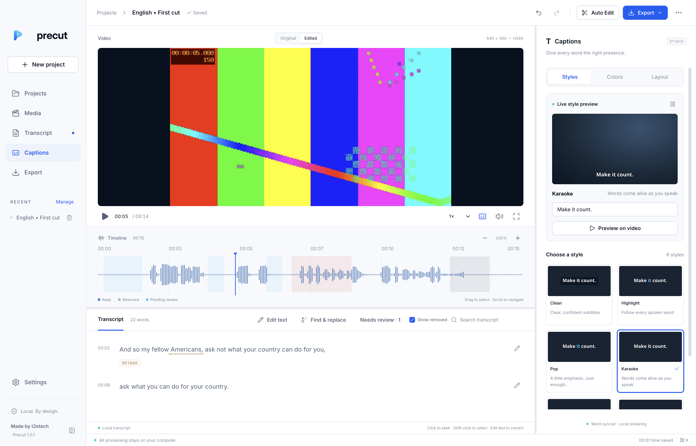

# Precut

**Skip the boring first edit.** An offline desktop first-cut editor for Thai, English and mixed speech. The current desktop build is **2.0.0**, with a real media engine and the verified T2ETECH licence SDK. Made by t2etech.



## Try it on this Mac

Double-click [`scripts/open-preview.command`](scripts/open-preview.command). It uses the included local Node 24 runtime and starts the Electron development app. The development export adapter applies only to unconfigured development sessions. Installed applications always require the real Precut product configuration for export.

The Apple Silicon installer is under `out/precut-1.0.0-mac-arm64.dmg`; the packaged application is `out/mac-arm64/Precut.app`. The installer is unsigned. See the detailed Thai guide [`docs/RELEASE_TO_STORE_TH.md`](docs/RELEASE_TO_STORE_TH.md) for Store setup, native CI inputs, repository binding, first publication and future updates. The actual packaged-app check is recorded in `docs/release-results-1.0.0-darwin-arm64.json`. macOS Intel and Windows x64 workflow targets are supplied; those platforms have not been built or certified on this host.

Import your own recording, run **Auto Edit**, apply **Clean safe edits**, review remaining suggestions using Before/After, choose a caption preset and export. Every edit is non-destructive and undoable. Use **Edit text** to click a word and correct it, or click the pencil beside a sentence. Press Enter to save; changing the selected word also saves your correction. **Find & replace** previews replacements within individual transcript words and applies them as one Undo step. Word timing is preserved unless you expand **Adjust word timing**. Drag the timeline to make a manual cut. Drag the panel separators to resize the workspace.

The caption studio has **Styles**, **Colors** and **Layout** tabs, an animated sample, and **Preview on video** to see the actual caption on your footage. Choose from six styles, color palettes, swatches or custom HEX colors. Text and active-word colors carry over between styles and are saved with the project. Remove a recent project using the trash button in the sidebar or Projects table; Undo restores it immediately, and **Removed projects** lets you restore it after restarting the app. Removal preserves source media and saved project data.

For Thai recordings with English terms, choose **Thai + English terms** and **High · Large v3** in Auto Edit, and add known names to **Names & specialist terms**. High uses the installed Large v3 model. **Re-transcribe with fresh analysis** discards the old speech cache; corrected words and existing editing decisions remain protected. Auto Edit applies new high-confidence Silence/Pause cuts as one Undo step by default. **Reassess previously kept pauses** explicitly reevaluates previously kept pauses; otherwise Keep remains unchanged. Review words shows unresolved recognition and timing issues. See [`docs/SPEECH_QA.md`](docs/SPEECH_QA.md) for the measured speech update and its limits.

Auto Edit opens a live progress view with five steps, worker-reported progress, an activity animation and elapsed time. Choose **Continue in background** to keep editing; the banner above the player keeps showing progress and lets you reopen it. Completion offers **Review edits**. Cancellation waits for the worker to stop before offering Retry. The progress reaches 100% after the final job acknowledgement, and overall progress stays monotonic during retries or CPU fallback.

## Development

Use **Node 24.21.0** and **pnpm 11.5.2**. No global TypeScript or Electron installation is needed.

```sh
pnpm install --frozen-lockfile
pnpm verify:sdk
pnpm typecheck
pnpm test
pnpm dev
```

`preinstall` and `build` verify the vendor signature, manifest and archive hash. Native SQLite is rebuilt for Electron automatically. Vite serves the sandboxed renderer; esbuild builds main, preload, database and job workers. Renderer hot reload does not reload Electron main-process changes; restart the dev command after changing main/preload code.

```sh
pnpm build
pnpm fixtures:prepare
pnpm test:e2e
pnpm test:media       # also needs the FLEURS Thai fixture
node scripts/recovery-smoke.mjs
node scripts/disk-full-smoke.mjs  # disposable macOS disk image
node scripts/performance-smoke.mjs  # macOS benchmark, creates a 120-minute fixture
node scripts/release-smoke.mjs   # actual production-configured packaged app, isolated QA project
node scripts/speech-accuracy.mjs # existing High model + prepared Thai/English references
node scripts/speech-safety.mjs   # generated soft voice/background/offset regressions
pnpm test:speech-benchmark final 3 # private, pre-change baseline fixture required
pnpm native:verify
pnpm package:dir
pnpm package
```

Generate the Thai fixture with `python3 scripts/prepare-thai-fixture.py` for development QA. Python is used only by that optional fixture downloader; **it is not used or required by the installed app**. The main fixture generator and product engines use the bundled native tools.

## Structure

| Location                | Responsibility                                                                                                                                         |
| ----------------------- | ------------------------------------------------------------------------------------------------------------------------------------------------------ |
| `apps/desktop/src`      | React app, semantic theme tokens, shadcn-style Radix controls, Canvas preview/timeline, virtualized transcript, caption studio, model/licence settings |
| `apps/desktop/electron` | Main/preload trust boundary, SQLite utility process, cancellable utility workers, licence boundary and export orchestration                            |
| `packages/shared`       | TypeScript contracts and strict Zod IPC payload schemas                                                                                                |
| `packages/core`         | Rational frame mapping, cleanup rules, caption scene/rendering specification, XML interchange, durable artifact recovery                               |
| `packages/media`        | Probe/fingerprints, bounded process pipes, process-group termination and orphan recovery                                                               |
| `packages/speech`       | Thai grapheme-safe segmentation and Whisper token timing alignment                                                                                     |
| `vendor`                | Signed `@t2e/license-sdk@1.0.0-rc.1`, verifier and pinned public release key                                                                           |
| `native`                | Verified platform sidecars and bundled Fast/Silero models; excluded from Git and included in installers                                                |
| `docs`                  | Product brief, architecture, measured QA results, native provenance and release requirements                                                           |

## Licence integration

Identity is **PC / `com.t2etech.precut`**, with callback **`com.t2etech.precut://oauth/callback`**. Import, analysis, review and captions are available without activation. Each export format goes through `runWithAccess({ feature: "export", operationId, recovery }, engine)`. MP4 plus its SRT sidecar is one operation. Production has no developer fallback.

Supply the store-generated **`product.config.json`** at the repository root, following [`docs/LICENSING.md`](docs/LICENSING.md). The current local `product.config.json` supplies the public PC product configuration. Account connection and trial settings are displayed separately from purchase activation. Signing credentials are still needed for signed distribution. Do not use the existing LX reference configuration from another product.

Unsigned releases use manual downloads from the Precut Store page. Empty installer publisher pins do not block licensing; the SDK's signed automatic installer path remains unchanged. `pnpm release:build` checks the stable app version, production config, tests and native integrity, then packages the current OS/architecture and creates the exact-version installer manifest. It does not publish the product. Tag-driven Store submissions use `.github/workflows/release.yml` and the reusable `.github/workflows/store-release.yml`.

## Native distribution

This workspace already includes a verified macOS arm64 native bundle and the multilingual base/Silero models. `pnpm models:prepare` restores the pinned bundled models. Larger speech/E5 models are optional downloads behind an explicit confirmation in Settings.

For another machine/architecture, see [`docs/BUILDING.md`](docs/BUILDING.md). The installer CI requires a SHA256-pinned approved native bundle for each OS target. The installed app runs its bundled binaries and models directly; it does not invoke Homebrew, Python, Node or a system FFmpeg.

## Verification status

See [`docs/QA.md`](docs/QA.md) for measured results and exact limits. Automated XML structure/source-range tests passed. Import acceptance inside Premiere, Final Cut and Resolve, live Precut licence/quota/device-limit tests, signed installers and long creator-recording accuracy/soak tests remain release requirements. The Fast model is a quick draft model; word timestamps can be estimated and are editable.

## Native login and branding

`pnpm start` builds and launches the native macOS/Windows application instead of the generic Electron runner. Quit any older Precut/Electron session first. Native callback registration, the early callback listener and the persistent global sign-in modal work together for browser return. `pnpm dev` and `pnpm start:unpackaged` remain development workflows; use the private return-link fallback shown in the modal when the generic runner cannot receive a custom-scheme link.

`precut-brand-kit` is the source of the supplied app icon and vector wordmarks. Build/dev copy these into native packaging and renderer assets automatically. The sidebar, account modal and About panel use “Made by t2etech”; the displayed version comes from `package.json`.
